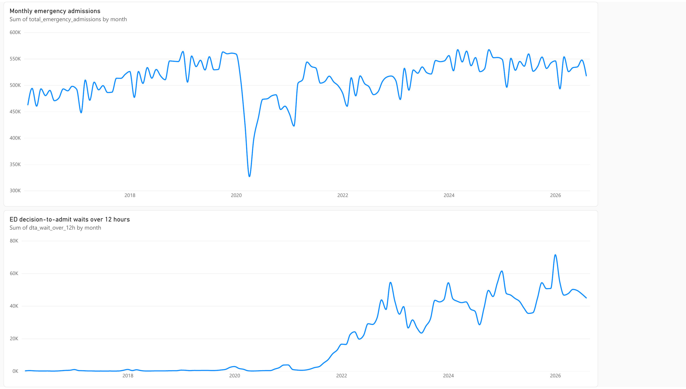
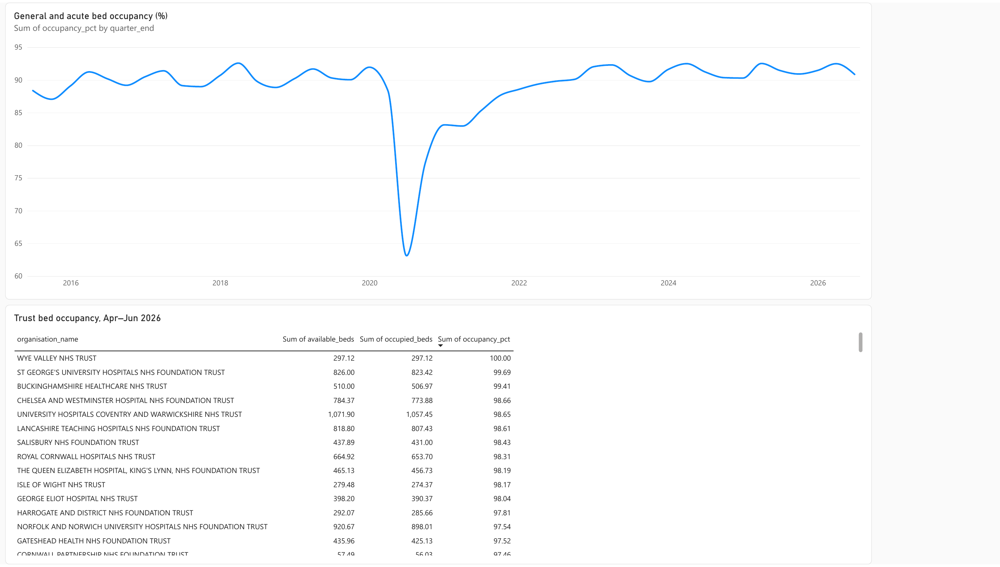
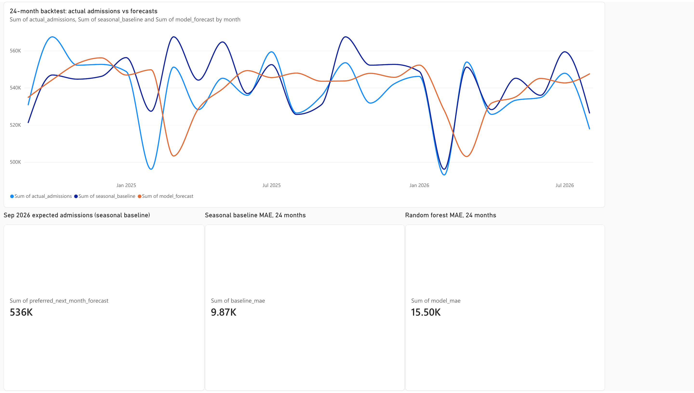

# NHS England Emergency Demand & Capacity Analytics

[](https://github.com/Tansari2004/nhs-emergency-demand-analytics/actions/workflows/verify.yml)

An end-to-end SQL, Python, forecasting, and Power BI project using **published NHS England aggregate statistics**. It studies emergency demand, long waits after a decision to admit, and general-and-acute overnight bed occupancy. The pipeline is **NHS workbooks and CSVs → SQLite → Python analysis and backtest → Power BI report**.

This project contains **no patient-level records**. It does not estimate individual length of stay or an individual's ED-to-ward transfer time.

**Explore the project:** [Updated editable PBIP source preview](powerbi/NHS_Analytics_Source_Preview.zip) · [Measures, filters and verification](powerbi/upgrade/README.md) · [Current data and backtest CSVs](powerbi/data/) · [Python pipeline](src/) · [SQL queries](sql/analytics.sql)

The updated source adds explicit measures, independent date/trust filters and
expanding-window forecast evaluation. Source/data checks pass; native Power BI
refresh, DAX execution and rendered interactions remain unverified. The
[original PBIX](powerbi/NHS-Emergency-Demand-Capacity-Analytics.pbix),
[PDF](powerbi/NHS-Emergency-Demand-Capacity-Analytics.pdf) and images below retain
the original fixed-fit experiment; they have not been relabelled as the upgrade.

## Original Power BI report preview (fixed-fit evaluation)

These images show the three pages of the completed report. The [live Power BI report](https://app.powerbi.com/groups/me/reports/1b968d56-f28b-4835-8f77-d6d0dac681f2) requires access to its private workspace; the editable `.pbix`, PDF, images, and data are public here.

### Emergency demand



### Bed pressure



### Admission forecast



## Sources and scope

| NHS England publication | Used for | Coverage in this project |
| --- | --- | --- |
| [A&E Attendances and Emergency Admissions](https://www.england.nhs.uk/statistics/statistical-work-areas/ae-waiting-times-and-activity/) | Monthly attendances, emergency admissions, and numbers waiting over 4 or 12 hours **after a decision to admit** | February 2016–August 2026, England total |
| [Bed Availability and Occupancy Data – Overnight](https://www.england.nhs.uk/statistics/statistical-work-areas/bed-availability-and-occupancy/bed-data-overnight/) | Average available and occupied general-and-acute beds | June 2015–June 2026, 45 calendar quarters |
| Same bed publication, Q1 2026–27 workbook | Latest trust-level general-and-acute bed snapshot | April–June 2026, 153 trusts with beds |

The monthly [A&E time-series workbook](https://www.england.nhs.uk/statistics/wp-content/uploads/sites/2/2026/09/Monthly-AE-Time-Series-August-2026-YG43sd.xls) was published 10 September 2026. The first months in that workbook include estimated fractional attendances, so the project begins with February 2016, when the selected counts are whole numbers. The bed CSVs end in June 2024; the importer continues the series with the individual [quarterly workbooks](https://www.england.nhs.uk/statistics/statistical-work-areas/bed-availability-and-occupancy/bed-data-overnight/) through June 2026. File URLs and SHA-256 hashes are pinned in `src/ingest.py` so a later NHS revision cannot silently change the reproduced results.

NHS England makes these publications available under the [Open Government Licence v3.0](https://www.nationalarchives.gov.uk/doc/open-government-licence/version/3/). The MIT licence here covers this project's original code and documentation, not NHS source files.

## Build and verify

Use Python 3.9 or newer and `curl`. From the repository directory:

```bash
python3 -m venv .venv
.venv/bin/python -m pip install -r requirements-repro.txt
.venv/bin/python src/ingest.py
.venv/bin/python src/analyze.py
.venv/bin/python src/forecast.py
.venv/bin/python src/validate.py
.venv/bin/python -m unittest discover -s tests -v
```

On Windows, replace `.venv/bin/python` with `.venv\Scripts\python.exe`. The importer downloads the official files into `data/raw/` and verifies their hashes. It creates `data/processed/nhs.sqlite`; dashboard import CSVs appear in `outputs/powerbi/`. These generated files are excluded from Git. If a hash fails, review the updated NHS publication before changing the pinned version.

## Measures and limits

| Measure | What it means |
| --- | --- |
| Emergency admissions | NHS England's monthly England total, split into admissions via A&E and other emergency admissions. |
| Decision-to-admit waits over 4 or 12 hours | Number of patients crossing the stated threshold after the decision to admit. These are **counts**, not average wait times or all ED waits. |
| General-and-acute bed occupancy | Published average occupied overnight beds divided by average available overnight beds for each quarter. |
| Latest trust capacity | General-and-acute available and occupied overnight bed averages in the April–June 2026 workbook. Trust snapshots are **not** admission volumes by trust. |

The admissions time series includes NHS and independent-sector organisations, while the KH03 bed series covers NHS organisations. They have different populations and time grains and are **displayed separately**, never added together or used to calculate a combined rate. The [NHS A&E data-quality notes](https://www.england.nhs.uk/statistics/statistical-work-areas/ae-waiting-times-and-activity/data-quality/) describe changes in provider coverage and reporting; comparisons around the pandemic and reporting changes need care.

## Verified example results

| Result | Value |
| --- | ---: |
| Emergency admissions, August 2026 | 517,868 |
| Decision-to-admit waits over 4 hours, August 2026 | 118,550 |
| Decision-to-admit waits over 12 hours, August 2026 | 44,951 |
| General-and-acute overnight occupancy, April–June 2026 | 90.85% |

The August 2026 monthly figures and the April–June 2026 bed figures are separate reporting periods.

## Forecast evaluation

The target is **next-month England emergency admissions**. The model uses month-of-year, month length, year and admissions from previous months only. A random forest is tested against a seasonal baseline: use the same month one year earlier. The expanding-window evaluation retrains before each of 24 targets, September 2024–August 2026, using only preceding monthly observations. Every output row records the training end and row count. The original forest fitted once through August 2024 remains a comparison on the same targets. Parameters are unchanged. After evaluation, a final forest is fitted through August 2026 for the historical September 2026 estimate.

| Method | Test MAE, admissions/month |
| --- | ---: |
| Same month last year | 9,874.21 |
| Random forest, expanding window · 24 refits | 13,134.67 |
| Original random forest, fixed August 2024 fit | 15,501.42 |

Refitting improves the forest, but the baseline still has **24.8% lower MAE**
than the expanding forest. This is a retrospective observation-time comparison
on a previously examined period; it does not simulate NHS publication delays or
establish prospective accuracy. [Original exports](powerbi/legacy_fixed_fit/)
preserve the fixed-fit results and explain the version boundary.

The baseline performed better and is the preferred demonstration forecast: **535,580 emergency admissions for September 2026** as of August 2026. This is a historical as-of forecast; it is not a live prediction for the current month. MAE measures absolute forecast error; neither method is claimed to improve hospital outcomes.

## Outputs and Power BI

`outputs/powerbi/` contains `monthly_demand.csv`, `quarterly_beds.csv`, `trust_beds_2026q2.csv`, `source_summary.csv`, `admissions_forecast_backtest.csv`, and `admissions_forecast_summary.csv`. A snapshot of these six aggregate exports is included in [`powerbi/data/`](powerbi/data/) for direct inspection. The updated source preview embeds the current CSV snapshot and adds its own independent dimensions. The original [three-page Power BI report](https://app.powerbi.com/groups/me/reports/1b968d56-f28b-4835-8f77-d6d0dac681f2), created in October 2026, used five imports and retains the older fixed-fit forecasts. Its private workspace, [PBIX](powerbi/NHS-Emergency-Demand-Capacity-Analytics.pbix), [PDF](powerbi/NHS-Emergency-Demand-Capacity-Analytics.pdf) and [page images](powerbi/images/) have not been refreshed by this upgrade. The [report notes](powerbi/BUILD_GUIDE.md) distinguish those artifacts from the updated editable preview. Raw NHS files and the local SQLite database are not stored in Git; the importer downloads and rebuilds them from the cited sources.

**Accurate resume wording:** “Analyzed NHS England emergency-admission trends, decision-to-admit delay counts, and published bed occupancy; compared next-month admission forecasts with a seasonal baseline and built a Power BI report to communicate the results.”

## Updated Power BI source

The [PBIP preview](powerbi/upgrade/README.md) includes 23 explicit DAX measures,
three pages with 26 native visual definitions, independent demand/quarter/trust/
evaluation selectors, and fixed interpretation panels. Single-quarter occupancy
uses occupied/available beds; multiple complete quarters use a bed-day-weighted
ratio. Selected trust occupancy uses the ratio of totals, never a sum of
percentages. Missing prior-year coverage yields blank YoY measures.

Four independent dimension relationships preserve the separate source grains.
Native refresh, DAX execution, rendering and interaction checks are still
required in Power BI Desktop for Windows before replacing the original report.
